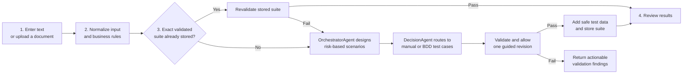
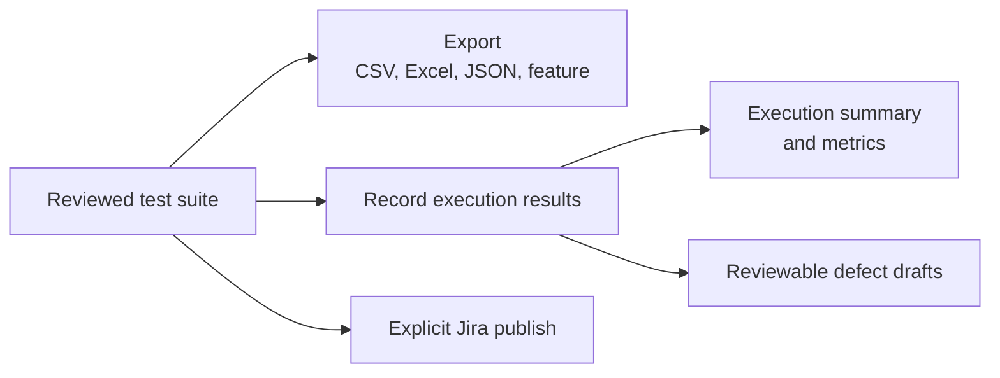
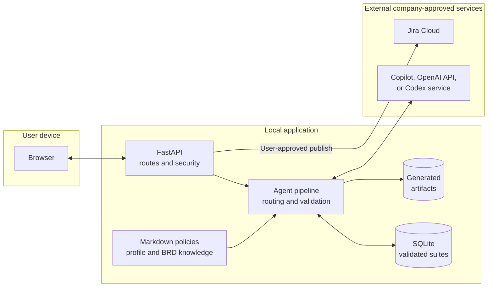
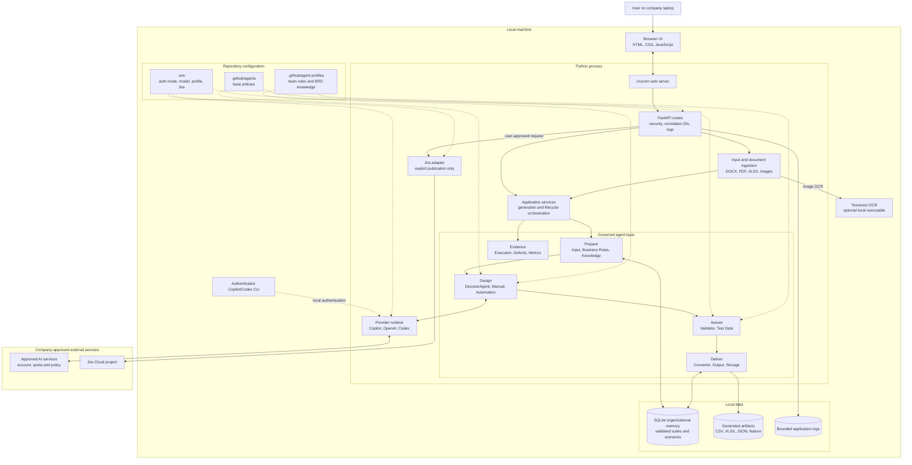

# Auto Finance Quality

Automobile finance test design from quotation requirements to reviewed execution evidence.

Android and iOS projects are available in [`mobile/`](mobile/README.md), including
a local browser preview, emulator/simulator instructions and automated mobile UI
checks. The mobile apps connect to this FastAPI backend; AI and automation execution
remain server-side. See the mobile guide for native testing and store-release steps.

The workspace is tailored to vehicle finance quotation testing, with guidance for PCP, HP, LP,
PCH, BCH, PFL and BFL. Its existing `auto-finance-quotation` profile supplies the domain baseline;
current requirements and approved contracts remain authoritative. The product guide is reference
material and does not silently insert business rules, financial formulas or request fields.
Credit decisioning, contracting and servicing require separately supplied requirements.

Validated cases can also produce [JMeter and SQL/Oracle test script packs](docs/test-script-packs.md).
The execution dashboard provides run summaries, test-level evidence and filtered CSV exports.

A local web application that turns a user story, feature description, or acceptance criteria
into structured test cases. It classifies cases as critical, smoke, sanity, or regression,
generates safe synthetic test data, exports Xray-ready CSV/Excel/JSON through the Context
Converter Agent, and can attach the CSV to a Jira Cloud
story with a summary comment.

Requirements are entered through the main text box or document upload. The separate
**Inspect a website** UI section has been removed.

The main input now asks the orchestrator to interpret the requested outcome before generation.
`POST /api/workflow/intent` returns a structured AI interpretation: website framework,
test cases, explicitly requested stories, requirements review or clarification. The selected
provider is retained under the mandatory model policy. An unavailable provider returns an
error; it does not silently fall back to stories. Ambiguous inputs show questions without
starting downstream generation. A bare BRD or requirement no longer implies story creation.

The UI displays “How I understood your request” and routes to that artifact. API clients can
use `/api/agent/run` with `interpret_prompt: true` for the same interpretation and dispatch,
returning a `prompt-result` envelope with `intent`, `source_request` and `result`.
A structured `requested_workflow` can explicitly select a supported artifact after interpretation;
it does not approve business sources or permit execution. Legacy requests omitting
`interpret_prompt` retain their existing response contracts. Uploaded documents are extracted
before interpretation. Business-source and suite validation still apply to business testing.

An explicit prompt such as “Build a Selenium C# BDD automation framework for
https://example.com using a page object model, with smoke, sanity and regression tests”
uses the direct website-framework workflow. Server-side routing in `POST /api/agent/run`
inspects public HTML and returns a downloadable ZIP with executable observed-page checks,
page objects, bindings, input evidence and runner configuration. It does not require a
finance BRD or pass through stories/scenarios. No AI call is needed for these structural
checks. The response is identified by `workflow: "website-framework"`; `execution_status`
is `not_run`. Existing test-generation responses retain their suite/validation shape.

The direct route builds a .NET 10 Selenium/C#/ReqnRoll framework with concrete page
objects in `Pages/`, `[FindsBy]` element properties initialised by the community
DotNetSeleniumExtras.PageObjects.Core PageFactory, reusable components in `Pages/Components/`,
assertions in Services,
scenario-scoped browser setup and failure screenshots. `Features/Smoke/Smoke.feature`,
`Features/Sanity/Sanity.feature` and `Features/Regression/Regression.feature` contain
named tests. NUnit fixture metadata provides real `TestCategory=Smoke`, `Sanity` and
`Regression` filters without Gherkin tags. The unfiltered default command runs every test.
Completed frameworks open automatically in **Automation packs**. That tab lists concrete
page objects and all suite scenarios, previews the exact generated files as read-only text,
and downloads the existing ZIP. Language and framework dropdowns are populated from the
pack and disabled; website packs also lock Selenium, page-object design and target runtime.
These settings describe the artifact and cannot be amended independently of its files.
Changing the source starts a fresh generation context. Pack results survive workspace
navigation and tab-scoped/account-scoped draft recovery on reload, subject to browser storage.
The file picker remains available for browsing source; it does not edit configuration.

Smoke checks public page titles/readiness. Sanity checks published navigation between
discovered pages, native appearance selections with observed options, and document readiness.
Regression checks published headings, controls, dropdown options and page contracts. Input
fixtures and a page-object map retain the source evidence. Browser configuration defaults to
Chrome, with Firefox/Edge factories available for separately configured target environments.
The generator inspects at most five public pages; it does not claim full functional coverage.
Review and execute the downloaded project against the approved target. Login, submissions,
JavaScript-only journeys and business-rule assertions need additional evidence and expected
behavior. Unsupported stacks and multiple targets return an actionable error. Ordinary
requirements and uploaded BRDs retain business-source validation.

Website inspection remains available through the API for clients supplying reviewed
observations as a requirements source. Receipts verify extraction only and do not establish
business approval. Existing business baseline checks still apply, and generated automation
packs require review and target execution.

Inspection collects titles, headings, links and control metadata from up to three same-origin HTML
pages (API maximum five). It does not execute JavaScript, sign in, submit forms, or run tests.
JavaScript-only sites may yield little evidence; provide their journeys and selectors separately.
Public URLs on ports 80/443 without embedded credentials or query parameters are supported.
Private, loopback and metadata addresses are blocked, including through DNS and redirects.
Temporary HTTP 429/502/503/504 responses are retried at most three times, within the
existing 45-second discovery limit. Every attempt revalidates public DNS and redirects.
Other errors fail immediately. The operation summary shows the target error and request
reference. Retrying unchanged input reuses its completed intent interpretation; changes to
input or provider/settings require a new interpretation.
Requests have page-size, redirect and time limits; target cookies and workspace credentials are
never forwarded. The API is `POST /api/workflow/requirements/website` with
`{"url":"https://example.com/","max_pages":3}`. The result includes `pages`, `warnings`,
`description`, and `website_source_receipt`. Pass the description as `website_source_text` and
include it unchanged in generation's `description`, together with `website_source_receipt`.

Requirements can be pasted or uploaded as Word (`.docx`), text PDF, Excel (`.xlsx`), Apple
Pages (`.pages`), Apple Numbers (`.numbers`), PNG, or JPEG. Pages/Numbers packages are read from
Quick Look previews or legacy XML when available; binary-only IWA packages must first be exported
from the Mac as PDF or XLSX. A document-ingestion component extracts normalized text, the requirement-to-test-case
agent generates the suite, and an independent validator reports coverage, traceability,
duplicates, clarity, and expected-result quality. Image extraction uses local Tesseract OCR.

The application uses twenty discoverable agents across the test lifecycle. In addition to
requirement ingestion, manual/automation generation, validation, conversion, and storage, it can
normalize business rules, recall approved knowledge, fill privacy-safe test data, summarize test
execution, draft defects, and calculate quality metrics. `GET /api/agents` lists every agent's
responsibility, runtime, and capabilities. Only suites that pass independent validation are newly
stored for future exact-match reuse.

The homepage now provides five connected tabs:

1. **Requirements:** read a BRD upload, pasted command prompt, or linked Jira ticket. Review the
   extracted text and shared rules before continuing.
2. **Stories:** a senior auto-finance business analyst creates BRD-grounded stories with testable acceptance criteria and explicit owner questions. Approved business knowledge and reference-only domain context inform the analysis without adding unsupported scope. Review or edit them and
   select **Use these stories**.
3. **Scenarios:** create format-neutral coverage linked to those story IDs. Review or edit the
   preconditions, actions and expected results, then select **Use these scenarios**.
4. **Test cases:** choose manual, automation or both; generate and validate cases with ST/SC
   traceability. Existing review, acceptance, feature-file and automation-pack exports remain available.
5. **Execution:** record actual manual outcomes, or inspect and run configured ReqnRoll features.
   Automation is enabled only when the approved suite's exported feature exactly matches a file in
   the configured `AUTOMATION_PROJECT_PATH` project's `Features/` directory. Install the reviewed
   complete pack, dependencies, bindings and approved input data and configure the target environment
   first. Set `API_BASE_URL` and optional `API_BEARER_TOKEN`/`API_FIXTURE_FILE` in `.env`
   or the server environment for generated API packs. All features in that configured project run together; Scenario Outlines expand into examples.
   Submitted scenarios appear while the runner works; individual outcomes and example names come
   from TRX results when the run finishes. Repository checks do not validate an unrelated generated suite.

Draft handoffs remain available while navigating within the workspace; reloading the page clears
these drafts. Changing requirements clears downstream drafts and execution results. Story and
scenario policies live in `story-generator.agent.md` and `scenario-generator.agent.md`; stage 4's
conversion instructions live in `workflow-test-cases.agent.md`. Story/scenario generation uses the
configured artifact-provider fallback (Copilot, configured OpenAI, then available Codex); test-case
generation retains the existing selected provider routing. No Jira stories are published automatically.

The `/api/workflow` endpoints expose document reading, stories, scenarios, validation of edited
handoffs, test-case conversion, execution planning and controlled execution. Open API documentation
for their schemas. Validation rejects duplicate IDs, unsupported source excerpts and broken story links.

Agent behavior is defined in readable `.github/agents/*.agent.md` files. The FastAPI/Python layer
loads the relevant DecisionAgent, specialist, and quality-gate policies into each Copilot session and
retains deterministic enforcement for validation, conversion, storage, security, and the web UI.
Team and project customization is layered through `.github/agent-profiles/<profile>/`. Set
`AGENT_PROFILE` to select a profile; `profile.md` applies common rules and optional files named
after an agent add role-specific conventions. The base safety and quality policies cannot be
replaced by a profile.

The active default is `auto-finance-quotation`. Its `knowledge/quotation-brd-baseline.md` is the
reviewable BRD v1.0 knowledge source used by the agents. This is prompt-time grounded context, not
irreversible model fine-tuning; updating or reverting the Markdown changes the baseline cleanly.

At generation time, choose manual test cases, BDD automation scenarios, or both in the same run.
Manual cases appear as compact scenario/title rows that expand to show preconditions, numbered
`Step 1`, `Step 2` actions, corresponding expected results, test data, and traceability. Automation
scenarios use `Scenario / Given / When / Then`. Both formats retain category, priority,
automation/manual feasibility, a decision rationale, test data, acceptance-criteria traceability,
and CSV/JSON/Jira export support.

BDD output is ready for SpecFlow/ReqnRoll feature files. Shared setup is promoted into a feature
`Background`, while repeated quoted and numeric values are parameterized for reusable C# bindings.
Data-driven flows use `Scenario Outline` with parameter placeholders and `Examples` tables where
appropriate. The results screen can copy a scenario or feature and generate, review, copy, and
download ReqnRoll C# step definitions. Choose **Step definitions (.cs)** for a single file
containing reusable binding declarations and pending method stubs to implement in your framework.
This option makes no AI calls and does not retrieve or generate implementation packs.
Choose **Automation pack** separately to generate implementations and supporting files, with a ZIP
download. Both options require a validated suite containing automation Gherkin.

Automation pack validation uses Tree-sitter to parse C#, Java, JavaScript, TypeScript and Ruby
step-definition code. It rejects malformed syntax and conditional branches with file, line and
column diagnostics, including branches inside interpolated strings. Literal text and comments do
not count as branching. Binding attributes, annotations and Given/When/Then calls also identify
step definitions outside the standard folder. Python retains its built-in AST parser. The parser
and grammar wheels install with the application dependencies; validation requires no network
access. These static checks complement target-language compilation and actual BDD execution.

The full C# pack generator includes executable common API bindings for named JSON request
fixtures, explicit HTTP method/path submission, status checks, JSON field checks, and exact decimal
comparisons. It supplies a scenario context and an `IHttpClientFactory`-backed client alongside the
bindings. Download the ZIP and retain its separate `.cs` files in a .NET 8+ ReqnRoll project with
`Microsoft.Extensions.Http`. This follows the [ReqnRoll context injection](https://docs.reqnroll.net/latest/automation/context-injection.html)
and [.NET HTTP client factory](https://learn.microsoft.com/en-us/dotnet/core/extensions/httpclient-factory)
patterns.

Set `API_BASE_URL` and, when needed, `API_BEARER_TOKEN` in the test environment. The step
`When the request is submitted` additionally requires `API_REQUEST_METHOD` and `API_REQUEST_PATH`.
Approved JSON object/array values in structured `test_data` become fixtures keyed by their names;
`API_FIXTURE_FILE` can instead point to a JSON object mapping fixture names to request payloads.
Missing/conflicting fixture data fails explicitly. Complete common-step suites use the implemented
bindings directly. Other suites use Copilot, with configured OpenAI/Codex fallback, to implement
their additional steps from the approved suite and common implementation baseline. A static
implementation check rejects placeholder/pending code, empty and throw-only methods, missing
coverage, and missing binding methods. Each provider gets one implementation revision before
the next configured provider is tried; schema-valid but incomplete code also triggers fallback.
Providers that fail transport/authentication/quota checks are not retried during that revision.
Validated C# bundles are stored in organizational memory. Repeated automation scenarios reuse
the complete bundle without another provider call, including when case IDs or ordering change.
Matching preserves Gherkin, fixtures, preconditions, expected results and project context;
changed instructions or support templates invalidate earlier matches. For suites combining
duplicate and new scenarios, matching stored C# is supplied as implementation knowledge and
the resulting complete bundle is validated again. Retrieved bundles also pass the current
static checks; these checks do not establish compilation or successful execution. Set
`ORGANIZATIONAL_MEMORY_ENABLED=false` to disable both C# storage and retrieval.
Missing runtime values (fixtures, outcome mappings, oracle outputs, field paths and tolerances)
can be loaded by concrete generated code from validated configuration documented in artifact notes.
These values must be supplied before running the tests; unknown business rules are never invented.
Unchanged shared C# helpers are assembled locally instead of regenerated by the model. Incomplete artifacts
are never returned as C# files or made downloadable. If all providers are unavailable or required
project contracts remain missing, the app reports the generation issue instead of emitting stubs.
The static check does not replace compiling and running the generated code in its target project.

The repository also includes a live C# BDD automation project at
`automation/QualityLifecycle.Automation.csproj`, separate from the Python unit and integration
tests under `tests/`. Its ReqnRoll features cover the UI
workspace, health and validation APIs, protected generation requests, and provider-secret
redaction checks. The project uses Playwright for browser scenarios and `HttpClient` for API
scenarios; configure `QUALITY_LIFECYCLE_BASE_URL` (and, for protected environments,
`API_AUTH_TOKEN`, `APP_USERNAME`, and `APP_PASSWORD`) before running it. See
`automation/README.md` for setup and tag filters. The C# projects are grouped in
`QualityLifecycleStudio.sln`.
The **Run BDD tests** action on **Progress & execution** invokes this fixed project through the
local Automation Execution Agent, without requiring a generated suite. It does not accept shell commands
from the browser; only approved environment values are passed to the process, output is bounded
and secrets are redacted. The results describe the fixed repository checks, not the generated scenarios, and do not
feed generated-suite metrics or defects. The runner reads structured TRX results, streams a
bounded output tail, and terminates the process tree on timeout or cancellation. Missing
results are reported as runner errors rather than invented test failures.

The step `Given fixture <fixture> sets <customerType> and <productType> as <eligibility>`
also supports quoted values and selects an approved eligibility fixture record. Its named fixture
uses `{"eligibilityCases":[{"customerType":"…","productType":"…","eligibility":"…",
"request":{…}}]}`. Supply real approved values and request fields through `test_data` or
`API_FIXTURE_FILE`. Customer/product fields in the request must match the selected record.
Only `request` is submitted; the fixture's eligibility metadata never becomes an API payload field.
This is fixture selection, not a change to downstream eligibility configuration. Missing,
duplicate, or inconsistent combinations fail with a specific fixture-data error.

Run the generated C# compile/runtime regression check with
`RUN_CSHARP_TESTS=1 python3 -m pytest tests/test_reqnroll_implementations.py -q`
(requires .NET 8+ and NuGet access or cached dependencies).

Before calling an AI provider, the application checks a repository-local organizational memory at
`.agent-memory/test_suites.db`. An exact normalized match returns the previously validated suite
immediately and avoids a new premium request. New results are stored for subsequent reuse. The
database is local operational data and is excluded from source control.

Generation preserves every unique case produced from the supplied requirements, business rules,
agent policies, and quality-gate feedback. The final count is coverage-driven rather than capped by
the application, although provider response-size, latency, and account limits still apply. Before
delivery, select individual cases in **Generated Suite**. Downloads, Jira publication, reviewer
entry, and **Approve selected** are kept together there. Reviewer and Jira issue fields show inline
validation. Multi-step Excel exports merge repeated case-detail cells instead of duplicating them
on every step row.

The UI shows payload-free orchestration events in the generation popup and lifecycle panel.
**Run in background** shows a compact bottom-right banner with a running indicator,
completed-stage percentage and **Open** action. This applies to BA review, stories, scenarios,
test cases, execution and automation packs. Reopening preserves recorded steps, files and elapsed
time. Finished progress remains available until dismissed or a new run starts. Progress follows
reported milestones; 100% is shown only after the operation returns successfully.
The top-right notification bell records run completion, failures, and system updates. A separate notice
tells the user when an approved exact-match suite came from the knowledge base. Sign out is
available from the adjacent profile menu rather than the sidebar.

## Run locally

Use **Review comments → Save review & regenerate** in the generated suite to request changes
for manual, automation, or combined tests. Mention case IDs for targeted corrections. The app
saves the comments before regeneration, preserves the original text or extracted document,
business rules, testing mode, and selected provider, and sends the feedback through the normal
specialists and quality gate. Failed or cancelled regeneration retains the previous suite and
saved comments; successful regeneration clears prior approval and generated file previews.

Feedback is stored in the organizational knowledge database and reused for the same requirements,
business-rule context, and testing mode, including when the provider changes. This is prompt-time
knowledge retrieval, not model fine-tuning. The latest ten reviews and a bounded index of previous
cases guide generation; only validated revised suites enter the reusable suite cache. Knowledge
storage must be enabled. `POST /api/reviews` saves feedback independently; `POST /api/agent/run`
then generates with the saved feedback. Both text and document generation responses include
`source_request` so reviews do not accidentally use subsequently edited input fields.

Saved suites carry a generation-policy version. A duplicate request matching older knowledge
generates a fresh suite using the current scenario and test-case naming instructions. Only a
Quality Gate-approved result replaces the saved suite; failed refreshes retain the earlier data.
Subsequent duplicates reuse the refreshed version without another generation call.

The LLM picker loads available routes from `/api/llm/models` instead of a fixed model list.
Unconfigured providers, failed access checks, disabled Copilot models and exhausted reported
Copilot quota are excluded. **Refresh models** checks access again; generation is disabled when
no route passes. OpenAI model permissions and Codex sign-in are checked without generation calls;
these checks do not establish remaining OpenAI billing credit or Codex usage allowance.

1. Install Python 3.11 or newer.
2. Create and activate a virtual environment:

   ```bash
   python3 -m venv .venv
   source .venv/bin/activate
   pip install -e '.[dev]'
   ```

Browser login is enabled when `APP_PASSWORD` and `SESSION_SECRET` are both configured. Set
`APP_USERNAME`, use a password of at least 12 characters, and generate a random session secret of
at least 32 characters. Signed sessions are stored in an HttpOnly, SameSite=Strict cookie and
expire after `SESSION_TTL_SECONDS` (eight hours by default). Bearer-token API clients remain
supported independently through `API_AUTH_TOKEN`.

3. Copy `.env.example` to `.env`.
4. Ensure GitHub Copilot CLI is installed, then authenticate it using your Copilot-enabled
   account:

   ```bash
   copilot login
   ```

   Your organization administrator must enable the Copilot CLI policy. For non-interactive
   deployments, configure `COPILOT_GITHUB_TOKEN` instead. Optional fallback providers are enabled
   with `OPENAI_API_KEY` and an authenticated Codex CLI (`codex login`).

5. Start the app:

   ```bash
   uvicorn app.main:app --reload
   ```

6. Open <http://127.0.0.1:8000>. API documentation is at `/docs`.

On Windows PowerShell, activate the environment with `.\.venv\Scripts\Activate.ps1`. If the
`uvicorn` command is not on `PATH`, use `python -m uvicorn app.main:app --reload` on any platform.

## Temporary guest access on Render

The Render Blueprint enables **Continue as guest** on the sign-in page until
**7 October 2026 at 23:59 London time**, using
`TEMPORARY_GUEST_ACCESS_UNTIL=2026-10-07T23:59:00+01:00`.
For an existing Render service, deploy this code, set that variable in **Environment**,
and choose **Save and deploy**. Keep `APP_PASSWORD`, `SESSION_SECRET`, and `API_AUTH_TOKEN`
configured. Normal sign-in remains available and gives the account its usual access.

Guests must select the button to receive a signed HttpOnly guest cookie. They can only view
**Quality workspace** and **Progress & execution**. A banner explains this limitation;
other navigation is hidden, and the server rejects other pages, APIs, and write operations.
Guests cannot generate tests, run executions, change data, or administer accounts. They can
browse execution history and download its reports. Guest access does not grant an administrator
identity. Signing out clears the guest cookie; signing in replaces guest access with the account.

The absolute deadline is checked on every request, including existing guest sessions; restarting
the service does not extend it. Open guest tabs return to sign-in at expiry. Remove or empty the
variable and redeploy to end guest access early. A different deadline must include a timezone.
Guest access is disabled when the variable is unset or no session secret is configured.

## Deploy on Render

The repository includes a `render.yaml` Blueprint for deploying the Dockerized FastAPI webpage as
a Render web service. In Render, choose **New → Blueprint**, connect this repository, and deploy
the Blueprint from the `main` branch. Render builds `Dockerfile`, binds the service to its supplied
`PORT`, and checks `/api/ready` before routing traffic.

During the first Blueprint setup, provide `APP_PASSWORD` (at least 12 characters), and provide
`COPILOT_GITHUB_TOKEN` and/or `OPENAI_API_KEY` if generation should be available in the hosted
service. `SESSION_SECRET` and `API_AUTH_TOKEN` are generated by Render. Add a custom domain to
`ALLOWED_HOSTS` if you use one; the Blueprint default allows the generated
`quality-lifecycle-studio.onrender.com` hostname.

This Blueprint disables organisational memory by default so startup does not require
an encryption key. For an existing service with memory enabled but no valid key, set
`ORGANIZATIONAL_MEMORY_ENABLED=false` in Render's **Environment** settings and redeploy.
To enable memory, first supply `ORGANIZATIONAL_MEMORY_ENCRYPTION_KEY` with a valid
Fernet key from your secret manager, then set `ORGANIZATIONAL_MEMORY_ENABLED=true`
(see [memory protection setup](docs/memory-protection.md#configure-before-enabling)).
Retain the original key for an already encrypted store; disabling memory preserves
the store but makes its contents unavailable to the application.

If startup reports `ModuleNotFoundError: No module named 'cryptography'`, the runtime
is missing a dependency already declared in `pyproject.toml`. Confirm the service is
building the intended commit with this repository's Dockerfile, then use Render's
**Manual Deploy → Clear build cache & deploy**. The Docker build checks dependencies
and imports the memory encryption module before proceeding. For an existing native
Python service, use `python -m pip install .` as its build command and
`python -m uvicorn app.main:app --host 0.0.0.0 --port $PORT` as its start command so
installation and startup use the same interpreter. The Docker deployment remains
required for the bundled .NET automation tooling.

The checked-in free-service Blueprint does not retain SQLite knowledge across Render
restarts, redeploys or spin-downs. For durable knowledge, use a paid service with a
persistent disk mounted at `/srv/app/.agent-memory` (the current database directory),
or implement an external database backend. Setting `ORGANIZATIONAL_MEMORY_ENABLED=true`
enables reuse but does not make the filesystem persistent. Back up existing databases
before changing storage; mounting an empty disk does not transfer previous data.
See [Render persistent disks](https://render.com/docs/disks) and
[free-service storage limitations](https://render.com/docs/free#local-files-lost-on-redeploy).

Knowledge source separates validated test suites from saved story/scenario batches.
A zero suite count does not mean that workflow knowledge is empty. Use **Refresh knowledge**
and inspect Knowledge Agent events for the current request. Only matching requests can
reuse saved artifacts; changed inputs, model, rules or generation policies can cause a miss.

## Test lifecycle and API

The browser provides the main workflow. The HTTP API also exposes each governed lifecycle action
independently:

| Stage              | Endpoint                                        | What it does                                                                                           |
| ------------------ | ----------------------------------------------- | ------------------------------------------------------------------------------------------------------ |
| Inspect            | `GET /api/health`                               | Shows service, Copilot authentication mode, model selection, profile, and memory status.               |
| Discover           | `GET /api/agents`                               | Lists registered agents, responsibilities, runtimes, and capabilities.                                 |
| Observe            | `GET /api/logs`                                 | Returns bounded operational logs, optionally filtered by correlation ID.                               |
| Trace live         | `GET /api/generation/{request_id}/events`       | Returns incremental payload-free agent lifecycle events.                                               |
| Accept             | `POST /api/output/accept`                       | Stores selected approved manual and automation artifacts in the fixed output directory.                |
| Generate           | `POST /api/generate`                            | Generates test cases directly from a validated JSON request.                                           |
| Orchestrate        | `POST /api/agent/run`                           | Runs the governed multi-agent generation and validation pipeline.                                      |
| Upload             | `POST /api/generate/document`                   | Extracts a supported document and generates a validated suite.                                         |
| Override rules     | `POST /api/business-rules/document`             | Extracts a document into a reviewable replacement business-rule overlay.                               |
| Expand             | `POST /api/generate/expand`                     | Adds distinct risk-based coverage to an existing suite.                                                |
| Cancel             | `POST /api/generation/{request_id}/cancel`      | Requests cancellation of an active generation.                                                         |
| Enrich             | `POST /api/test-data`                           | Fills missing test data with case-aligned synthetic values.                                            |
| Record             | `POST /api/execution`                           | Validates execution results and calculates a pass-rate summary.                                        |
| Triage             | `POST /api/defects`                             | Creates human-review-required drafts for failed tests.                                                 |
| Measure            | `POST /api/metrics`                             | Calculates coverage, execution, and defect metrics.                                                    |
| Convert            | `POST /api/context-converter/{output_format}`   | Converts validated manual suites to CSV, Excel, PDF or JSON; automation scenarios to `.feature` files. |
| Export             | `POST /api/export/csv`                          | Produces a CSV download.                                                                               |
| Publish            | `POST /api/jira/publish`                        | Attaches selected cases to Jira after an explicit user action.                                         |
| Read Jira          | `GET /api/jira/issues/{issue_key}/requirements` | Reads a story description and Xray/Jira acceptance criteria.                                           |
| Generate from Jira | `POST /api/jira/generate`                       | Reads a Jira story and generates a validated test suite from it.                                       |

Execution results are supplied by an approved manual or automation source; this application does
not execute arbitrary test commands. Defects remain drafts until a person reviews them, and Jira
publication is never automatic.

## Engineering quality

The repository enforces a shared organizational baseline through executable checks:

```bash
make quality
```

This runs Ruff formatting/lint policy, MyPy type checks, tests with branch coverage, and Python
compilation. CI also audits installed dependencies for known vulnerabilities. The application
ships with JSON request logs, correlation IDs, baseline browser security headers, a non-root
container image, bounded document processing, sanitized provider errors, and an explicit
human-controlled Jira publication boundary.

## AI provider runtime

Automatic mode tries GitHub Copilot first, then the OpenAI API, then the locally authenticated
Codex CLI. The UI also allows a provider/model to be selected explicitly. Copilot uses either the
locally signed-in GitHub identity or `COPILOT_GITHUB_TOKEN`; OpenAI requires `OPENAI_API_KEY` with
separate API billing; Codex requires the `codex` executable and `codex login` on the machine that
runs the service. A local Codex login is not automatically available inside Render.

Provider quotas, rate limits, account eligibility, and model policies still apply. Leave
`COPILOT_MODEL` or `CODEX_MODEL` blank to use the relevant account default, and configure
`OPENAI_MODEL` for the API fallback. Never commit credentials. If all configured providers are
unavailable, the UI returns one combined, reference-ID-bearing error describing each provider.

Codex C# artifact generation uses `CODEX_ARTIFACT_TIMEOUT_SECONDS` (default 900 seconds),
separately from `CODEX_TIMEOUT_SECONDS` (default 300 seconds) for suite generation. Set the
artifact limit up to 1800 seconds for larger suites and restart the service to apply changes.

## Jira Cloud setup

Set `JIRA_BASE_URL`, `JIRA_EMAIL`, and `JIRA_API_TOKEN` in `.env`. The Jira user needs Browse
Projects to import stories, plus Add Attachments and Add Comments to publish results. The app uses
Jira Cloud REST API v3 and supports Jira projects with Xray by reading the native story description
and acceptance-criteria custom fields. Fields named `Acceptance Criteria` are discovered
automatically; set `JIRA_ACCEPTANCE_CRITERIA_FIELDS` to comma-separated custom-field IDs or exact
field names when your project uses different labels. In the browser, choose **Load story**, review
the imported requirement, and generate normally. The `/api/jira/generate` endpoint offers the same
fetch-and-generate flow in one API call.

Publishing is always initiated by the user and attaches an Xray-ready timestamped CSV; it does not
create or overwrite Jira/Xray issues. Jira Data Center and direct Xray test-issue creation require
separate authentication and adapters.

## Develop with GitHub Copilot

Open the folder in VS Code, install the GitHub Copilot and GitHub Copilot Chat extensions, and
sign in. Repository guidance is already provided in `.github/copilot-instructions.md`.

This repository also includes:

- `.github/agents/test-designer.agent.md`: a custom QA-focused Copilot agent.
- `.github/prompts/add-test-generation-feature.prompt.md`: a reusable agent-mode prompt.
- `.github/workflows/ci.yml`: GitHub Actions checks for every pull request and main-branch push.

In Copilot Chat, select the `test-designer` custom agent when designing or changing test-suite
behaviour. Use `/add-test-generation-feature` for implementation tasks where
prompt files are supported.

Useful Copilot Chat tasks:

- `Add unit tests for JiraClient using respx; cover attachment and comment failures.`
- `Add an editable review screen before publishing while preserving the TestSuite schema.`
- `Add an Xray Cloud publisher as a new adapter without changing JiraClient.`
- `Add Playwright end-to-end tests for generation, download, and validation errors.`

Always review generated code and test cases. The AI output is a draft, not evidence of coverage
or a substitute for security, accessibility, performance, and domain-expert testing.

## Architecture

The design is hybrid: GitHub Copilot proposes test content, while local Python code controls input
validation, routing, schema enforcement, quality gates, persistence, conversion, observability,
and external publication. Markdown files describe agent behavior and project knowledge, but they
cannot bypass these code-enforced boundaries.

### What happens when a user generates tests



The memory check can avoid a Copilot request for an exact known requirement. A stored suite is
still revalidated before use. For a new requirement, OrchestratorAgent reads the normalized UI or BRD
input and designs the scenario intent. DecisionAgent then selects the manual specialist, automation
specialist, or both to transform that intent into the requested manual or BDD test cases. Output
that still fails after one findings-driven revision is not
stored or offered for publication.

After generation, a user can choose only the actions they need:



### Where each responsibility runs



Only AI generation crosses the selected provider boundary. Document processing, validation, synthetic
fallback data, execution summaries, defect drafts, metrics, storage, and exports run locally.
Jira is contacted only when a user explicitly publishes selected cases.

### Complete infrastructure view

This diagram combines the deployment boundaries and major runtime components. Solid arrows show
runtime calls or data movement; dotted arrows show configuration supplied to the pipeline.



The entire FastAPI application, deterministic agent logic, SQLite memory, generated files, and
logs stay on the application host. Requirement content is sent only to the provider selected for
generation. Jira receives only the cases selected in an explicit publish request.

### Agent responsibilities

The eighteen roles are grouped below by purpose so their relationship is easier to scan:

| Group                | Agents                                                                   | Responsibility                                                                                     |
| -------------------- | ------------------------------------------------------------------------ | -------------------------------------------------------------------------------------------------- |
| Prepare              | Input, Business Rules, Knowledge                                         | Extract and normalize requirements, bind `BR-*` rules, and recall exact validated suites.          |
| Generate             | OrchestratorAgent, DecisionAgent, Manual Generator, Automation Generator | Ingest UI/BRD input, design scenario intent, and route it into requested manual or BDD test cases. |
| Assure               | Test Case Validator, Test Data                                           | Enforce coverage and traceability rules and fill missing values with privacy-safe synthetic data.  |
| Deliver              | Context Converter, Output, Test Storage                                  | Convert approved suites, retain artifacts, and store validated knowledge for exact-match reuse.    |
| Learn from execution | Execution, Bug Reporter, Metrics                                         | Validate supplied results, draft defects for review, and calculate transparent quality measures.   |

Agent behavior lives in `.github/agents/*.agent.md`. Team-specific rules and version-controlled
knowledge are layered from `.github/agent-profiles/<profile>/`; the default profile is
`auto-finance-quotation`. This is prompt-time grounding, not model training.

### Code map

- `app/agents/`: typed capability contracts, declarative agent definitions, and the shared
  fail-closed Copilot runtime.
- `app/agents/runner.py`: the sole owner of Copilot SDK sessions, restricted options, timeouts,
  event handling, JSON extraction, and Pydantic structured-output validation.
- `app/agents/lifecycle_agents.py`: business-rule, knowledge, test-data, execution, defect, and metrics agents.
- `app/agents/test_case_validator.py`: independent deterministic test-suite validation agent.
- `app/services/`: application use-case orchestration, independent of HTTP transport.
- `app/services/document_ingestion.py`: bounded Word, PDF, Excel, and image text extraction.
- `app/dependencies.py`: composition root for the approved runtime and application services.
- `app/generator.py`: test-suite request/normalization logic using Markdown instructions and the
  shared structured-agent runtime.
- `app/models.py`: validated API and model-output contracts.
- `app/jira.py`: Jira Cloud attachment/comment integration.
- `app/exporter.py`: CSV export.
- `app/static/index.html`: dependency-free browser UI.
- `tests/`: fast local tests; external APIs should always be mocked.

See [architecture](docs/architecture.md), [operations](docs/operations.md),
[engineering standards](docs/engineering-standards.md), [contributing](CONTRIBUTING.md), and
[security policy](SECURITY.md) for the organization-standard framework and governance rules.

For company adoption, use the [project prerequisites](app/documentation/company-project-prerequisites.md),
[solution requirements](app/documentation/company-solution-requirements.md), and
[implementation checklist](app/documentation/company-implementation-checklist.md) as the approval and delivery
pack.

For stakeholder presentations, use the [client demonstration guide](docs/client-demo-guide.md)
and the downloadable [client demo PowerPoint](docs/Quality_Lifecycle_Studio_Client_Demo.pptx).

## User accounts and roles

The account configured with `APP_USERNAME` and `APP_PASSWORD` is the initial administrator.
Sign in and open **Profile → Manage users** to create accounts with first and last names,
usernames, passwords, and either the **User** or **Admin** role. Users can access the workspace;
only admins can list accounts, create users, amend roles, and enable or disable access.
Use an account’s edit icon to populate the user form. Update first and last names, choose Role
and Application access with inline radio options, then select Update user. Leave the password blank
to retain it or enter a replacement. The username stays fixed. Cancel editing returns to
Create user mode. Saved edits revoke existing sessions. The delete icon removes an account after confirmation;
admins cannot delete themselves or the initial administrator. There is no public
registration. Disabling an account immediately invalidates its browser sessions. Re-enabling
requires a fresh sign-in. Admins cannot disable themselves or the initial administrator.

Accounts persist in `USER_DATABASE_PATH` (default `.agent-memory/users.db`). Passwords are
stored as salted scrypt hashes. Keep this database on persistent storage when deploying.
The existing API token grants workspace API access but cannot manage users; account management
requires an authenticated admin browser session. Configure browser login before granting access.

Specific-test reviews: mention exact test IDs (for example, `TC-003`) or full test titles in review comments. Regeneration replaces only those tests and preserves every other test and its position. Unknown test IDs are rejected. Revisions that omit or duplicate a requested ID, or change its execution mode, fail without replacing the displayed suite. Comments without a specific test apply to the whole suite.

Per-test review: click **Review** on a manual or automation test to reveal its comment form. **Save review & regenerate** saves feedback and updates only that test. The selected test ID is sent automatically; IDs mentioned within comments do not expand the review scope.

## Gemini test generation

Set `GEMINI_API_KEY` in the server `.env` and restart. `GEMINI_MODEL` defaults to
`gemini-3.8-flash` and can select another model supported by your account. Gemini appears
in the model picker when its metadata access check succeeds. The check does not verify
remaining generation quota. Automatic test generation tries Copilot, OpenAI, Gemini,
then Codex. Explicit Gemini selection uses Gemini only. Manual and BDD output use the
existing validation and review flow; blocked, truncated, and invalid responses fail.

The integration uses [Google’s structured-output REST API](https://ai.google.dev/gemini-api/docs/generate-content/structured-output).
Gemini support applies to test suites; the full C# pack retains its existing providers.

## Shared rules, standards and automation languages

The shared rules editor now reads and saves `.github/agents/business-rules.agent.md` on the server.
Only its marked shared-business-rules section is replaced; agent guidance is preserved.
See the [agent editing guide](.github/agents/README.md) for rules, conditions, and training examples.
Agent and profile Markdown edits take effect on the next request and invalidate stale generated suites.
This is the single persistent placeholder for project rules. Start with an empty array and add
objects such as `{"id": "BR-001", "description": "Your approved business rule"}`. Text and imported
rules from the editor are saved here before generation. Every generation pipeline loads the file
before knowledge lookup and provider calls. Existing API clients can still supply transient rules;
conflicts with a shared rule ID are rejected. Rules and standards apply across this workspace,
so shared edits affect other users. Keep the `workspace/` directory on persistent storage.

Edit `workspace/automation-standards.md` for automation conventions and
`workspace/feature-standards.md` for Gherkin conventions. Agents reread these files on generation.
Changes to feature standards invalidate cached suites while retaining saved review feedback;
C# implementation memory also incorporates the automation standards. Generated feature files have
no tags, including scenario, outline and Examples tags. Tag-looking text inside doc strings is
preserved as data. Existing repository smoke-test tags are independent of generated artifacts.

Choose **Automation language** before requesting step definitions or an automation pack:
C# (ReqnRoll), Java (Cucumber-JVM), Python (Behave), JavaScript or TypeScript (Cucumber-JS), or Ruby
(Cucumber-Ruby). The Multi Language Support Agent supplies language-specific pending declarations
for bindings-only requests. Full packs use the configured providers and the shared standards to
implement the approved scenarios, with static validation before delivery. New language packs
include dependency manifests, setup instructions and an untagged feature file. Missing project
contracts or incomplete provider output cause generation to fail; static checks do not establish
successful compilation or execution. Bindings-only adapters supply standard framework declarations;
custom coding conventions are provided to full-pack generation. Gherkin natural-language dialect
selection is separate from this programming-language selector and is not changed here.

The new endpoints are `GET/PUT /api/workspace/rules`, `GET /api/workspace/standards`,
`GET /api/automation/languages`, and `POST /api/step-definitions/languages/{bindings,pack,download}`.
Legacy C# endpoints remain available. The generic download endpoint safely archives reviewable
source files; it does not certify user-supplied files as complete implementations.
The adapters follow [Cucumber step definitions](https://cucumber.io/docs/cucumber/step-definitions/)
and [Behave regular expression matchers](https://behave.readthedocs.io/en/stable/tutorial/).

## BDD execution history and Allure reports

**Progress & execution** shows only runs of the existing repository BDD project,
`automation/QualityLifecycle.Automation.csproj`. **Run BDD tests** works without generating a suite.
Python/C# unit tests, test generation, automation-pack creation, and manually entered case results
are excluded from this view.

Each run records its timestamp, duration, status, bounded redacted output, and measured pass/fail/not-run
counts. Select **Show in chart** to view a historical run in the doughnut chart. Not run means the
runner reported a skipped test; missing results display as unavailable rather than inferred counts.
The page refreshes every five seconds and preserves the selected historical run.

The native `Allure.Reqnroll` adapter records scenarios and their steps. After execution, Allure 2
CLI generates a standalone HTML report with `--single-file`. Each report has a **Download Allure
report (.html)** link and opens locally without a report server. Install Java and Allure 2 CLI on
a local execution host and restore the BDD project before running; the Docker image already
bundles these prerequisites. For Render configuration, see `automation/README.md`.
Missing Allure prerequisites do not change the test result: the run shows a separate report error.
Older runs without Allure results cannot be retroactively given a report.

`POST /api/automation/run` accepts `{}` (legacy suite payloads remain accepted but do not select tests).
`GET /api/automation/history` returns only repository BDD runs. Authenticated report downloads use
`GET /api/automation/reports/{report_id}`. The existing `/api/dashboard` API remains available for
other workspace clients. One BDD run may execute at a time per server process.

History persists in `dashboard.db` beside `ORGANIZATIONAL_MEMORY_PATH`, retaining 200 BDD runs
independently of other activity. The latest 200 new HTML reports are retained in `automation/TestResults/Reports/`
(beside the configured automation project). Keep this directory on persistent storage.
Existing downloads also resolve historical reports from `automation-reports/` beside the database. Active runs are process-local.
Reports contain native scenario/step results and redacted text diagnostics; raw attachments are
excluded. Access uses the workspace's existing authentication settings.

## Lifecycle management API

The Quality Lifecycle page focuses on coverage, traceability and quality reporting.
Formal requirement approvals and execution management are available through `/api/stlc`;
the page does not include management forms. The following describes that API workflow.
Records persist in `stlc.db`
beside `ORGANIZATIONAL_MEMORY_PATH`; use persistent storage on the deployment host to
retain them across redeployments. This is a shared workspace, consistent with the existing
shared business rules. Project identifiers organize records; they are not tenant access boundaries.

1. Save a requirement with its project, stable key, owner, source, acceptance criteria and
   change reason. Submit it for review, then approve or reject with a recorded comment.
   Missing criteria and a small set of potentially ambiguous phrases prevent approval;
   this check supplements human review rather than proving requirement completeness.
2. Select approved requirement versions to create a baseline. Review and approve the
   baseline, then save the generated suite with explicit case-to-requirement mappings.
   Review its saved test snapshot and approve the suite version.
3. Create a cycle tied to that suite version, application build and environment, assigning
   each case. Record manual step outcomes and evidence URLs, or import CI `results.json`.
   Attempts are append-only. Imported run keys are idempotent; unknown cases, duplicate
   results and build/environment mismatches reject the whole import.
4. Create defects from failed attempts. Link an existing Jira issue or explicitly publish
   a Jira Bug, then synchronize its remote status. Jira status is displayed separately from
   local defect disposition: closing locally requires a passing linked retest. If remote
   creation times out, reconcile with Jira and link the created issue instead of retrying
   blindly. Jira projects must support the `Bug` issue type and the configured account must
   have the relevant issue permissions.
5. Revise a requirement to create a new version. The impact view identifies affected tests,
   suite versions and cycles. A changed baseline cannot start new cycles; review new
   requirements, baseline and suite snapshots first. Historical execution remains linked to
   its original version. Retesting a fixed build uses a new cycle for the same suite version
   and can reference a failure in an earlier cycle.

The cycle report counts the latest attempt per case, retains complete attempt history, and
shows whether all tests linked to a requirement passed. Pass rate uses passed plus failed
cases as its denominator; blocked and not-run cases remain visible separately. No execution
produces an unavailable pass rate. A passing requirement row describes that baseline only;
change-impact warnings identify newer requirements requiring review.

### Reviewed C# execution in CI

The application host never executes uploaded generated code. Generate and review a C# pack
for a saved suite and use the lifecycle API to export a reviewed CI bundle for its cycle. Provide the project's
relative `.csproj` path and explicit mappings from exact TRX test names to stable case IDs.
Outline rows may map to the same case; one failed row fails the aggregated case, and any
unexecuted row prevents a passing case result. Unmapped or missing cases stop conversion.

Commit the bundle as `automation-packs/<cycle_id>.zip` through your repository review process.
Configure the GitHub Actions environment `stlc-execution` with required reviewers, variable
`STLC_TARGET_URL`, and only the target-test credentials needed by the reviewed suite:
`STLC_TARGET_TOKEN`, `STLC_TARGET_USERNAME`, `STLC_TARGET_PASSWORD`. Manually dispatch
**Generated suite execution** with its cycle ID. The workflow verifies bundle hashes, builds
and runs on an ephemeral GitHub-hosted worker with timeouts, and retains TRX plus importable
JSON artifacts. Download `results.json` and import it into the matching cycle. The initial
implementation deliberately uses explicit import rather than giving generated code credentials
to write to the lifecycle application. Build errors yield CI diagnostics, not fabricated results.

GitHub environment/reviewer configuration and a real target environment are external setup
steps. The local application cannot configure those accounts automatically. See
[GitHub's runner security guidance](https://docs.github.com/en/actions/reference/security/secure-use)
and [Jira's issue API](https://developer.atlassian.com/cloud/jira/platform/rest/v3/api-group-issues/).

The `/api/stlc` API exposes requirement versions, baselines, suite versions, cycles, manual
attempts, imports, defects, Jira actions and reviewed bundle export. Audit actors come from
the signed-in session; bearer-token calls are identified as `api-service`. Open local
installations record `local-development`. Lifecycle snapshots and audit history survive
application restarts. Formal closure/sign-off and multi-framework CI remain subsequent work.

## Shared automation framework structure

The repository BDD project and all new automation packs use the folder structure in
[automation/README.md](automation/README.md) and
[workspace/automation-standards.md](workspace/automation-standards.md): `Reqnroll`,
`Features`, `StepDefinitions`, `Hooks`, `TestContext`, `Services`, `Builders`, `Models`,
`Utilities`, `TestResults/Reports`, and `Input`. These are sibling folders; build/dependency
manifests remain at the project root. `Reqnroll` is the configuration-folder name across
C#, Java, Python, JavaScript, TypeScript and Ruby; each retains its own BDD runtime.

Generation places bindings and helpers in their corresponding role folders and refreshes
`Features/generated.feature`, `Input/TestData.Json` (approved JSON request fixtures), and
`Input/CaseData.Json` (all supplied per-case data). Unused role folders contain documentation.
A C# full pack includes `Automation.csproj`; run it from the extracted root with
`dotnet test Automation.csproj --results-directory TestResults/Reports`.
Python packs run with `python Reqnroll/run.py`. The adapter temporarily stages the
[discovery tree required by Behave](https://behave.readthedocs.io/en/stable/gherkin/),
loading the authored StepDefinitions and Hooks while writing reports into the shared layout.
Other language packs must supply runner configuration for the same folder names.

Generation, download and reviewed CI bundle validation reject the previous `Support/`,
`src/test/`, and lowercase `features/` layouts; regenerate old packs before downloading or
exporting a new reviewed CI bundle. Existing repository project paths remain compatible.
The CI runner places TRX and importable JSON under `TestResults/Reports/ci-execution` in the
extracted framework, and uploads that directory as execution evidence.

### Code-generation validation context

Full-pack generation sends the current structured Quality Gate report alongside the suite.
A failed report, or a report marked passed while containing error findings, is rejected before
provider execution or code-cache reuse. Unfinished baseline bindings are implementation work,
not a failed design gate. Historical suite notes do not replace the current structured report.

Explicit service requirements and supplied rule IDs define scope; the default quotation profile
only supplies applicable quotation guidance. The approved quotation payload remains unchanged.
Suites cached under the earlier unconditional-profile policy are retained but regenerated on the
next matching generation request. The generator must still report missing business semantics and
must not invent contracts, fixtures or execution results.

If providers cannot complete all bindings, the user receives a short error with a reference ID.
Runtime logs retain implementation findings and provider notes for investigation. Provider notes
are diagnostic statements, not a replacement Quality Gate decision.

# Reusing repeated requirements

With organizational memory enabled, the workflow stores validated stories and scenarios
after their first generation. Submitting the same requirements and generation settings
recalls those stages through the Knowledge Agent, including across application restarts.
The unchanged reviewed handoff then uses the existing validated test-suite memory to
recreate test cases. Recall is shown in the workflow's lifecycle events.

Matching includes the source, additional context, business rules, generation settings,
reviewed stories, agent policies, and feature standards. Changes generate fresh artifacts;
similar wording is not treated as an exact duplicate. Recalled stages are validated again
before use. `ORGANIZATIONAL_MEMORY_ENABLED=false` disables this reuse. Earlier stories
and scenarios that were never stored need one initial generation to populate memory.

Local development can use [Microsoft User Secrets](docs/local-user-secrets.md) for the
Python app and C# BDD runner. This is opt-in; hosted configuration remains environment-based.

## Runtime configuration

Manage operational flags in [workspace/runtime-config.toml](workspace/runtime-config.toml),
using lowercase fields from `app.config.Settings`. The shared file controls the model-directed
coordinator, organizational-memory reuse, local User Secrets, BDD build reuse, JSON logging and
Tree-sitter diagnostic detail. It also accepts non-secret timeout, limit, path and profile options.
Agents consume resolved Settings values; feature switches do not belong in agent or skill prose.

For example, `model_directed_runtime_enabled = false` disables the resident coordinator while
retaining the deterministic pipeline. `tree_sitter_diagnostics_enabled = false` returns compact
pack-validation findings; syntax and branching checks still run. Mandatory Codex/Copilot models,
implementation approval, approved payloads and required automation checks remain enforced.

Precedence is explicit Settings arguments, process environment, Microsoft User Secrets, `.env`,
mounted secrets, runtime TOML, then application defaults. Remove duplicate operational flags
from an existing `.env` to manage them through TOML. Keep credentials outside the shared file;
credential keys, unknown options and malformed TOML are rejected. Select another file with
`RUNTIME_CONFIG_PATH`; a missing selected file causes an explicit startup error.
Restart the application after editing configuration because server Settings are cached.
The C# BDD runner retains its environment/User Secrets configuration.

## Auto-finance domain tools

Select a configured product and journey in the Quality workspace to ground generation in
reference templates and owner-approved rules. **Knowledge source → Domain pack & calculation
validation** provides Decimal validators for amount financed, monthly annuities/balloons and
net/VAT/gross reconciliation. The graph adds products, journeys and versioned business rules
with explicit links to requirements and test evidence.

Configure the pack in `workspace/auto-finance-domain.toml`; runtime flags stay in
`workspace/runtime-config.toml`. No organisational-memory migration or enabling is included.
The starter catalogue is reference-only, with no approved domain rules or inferred regulatory
limits. See [configuration, calculation conventions and live API checks](docs/auto-finance-domain.md).

## Detailed runtime logs

Open **Runtime logs** (`/logs`) to see one high-level record per reference ID, showing the
operation, outcome, latest timestamp, duration and event count. Expand a row to see its
chronological event timeline, structured fields, raw entries and safe exception call locations.
**View options → Expand records** opens every loaded record; records start collapsed. Search and severity
filters apply to records and downloads retain all loaded events for the matching records. Entries include millisecond timestamps, severity,
logger and correlation ID. **View options** contains UTC/local time, the log window and the
live-update switch. Use the single search box to filter messages and fields or submit an exact
reference ID; clearing it returns to recent records. Filter severity, use **Refresh**, or select
**Export** to download the currently filtered entries as JSONL. Live refresh runs
every five seconds while the page is visible. The graph links to the logs for its latest
snapshot request.

Logging records HTTP starts, completions, rejection reasons, response status, duration,
received byte count and agent-stage transitions alongside existing application events. It
does not capture request bodies, credentials, model prompts or exception messages. The
logging level still controls which events are emitted.

Configure retention in `workspace/runtime-config.toml` and restart the server:
`detailed_logs_enabled` controls extra request-start and agent-stage records;
`log_file_path`, `log_file_max_bytes` and `log_file_backup_count` control rotating JSONL files;
`log_ui_capacity` controls the in-process ring buffer. Defaults retain five 10 MiB backups
plus the active `.agent-memory/logs/application.jsonl` file and 5,000 in-process entries.
File writing uses a bounded background queue. In extreme queue saturation, file/console
records may be dropped while the in-process ring continues receiving entries.

The viewer loads up to 200 recent entries per request; it does not browse disk archives.
In-process history clears on restart; rotating files persist and are excluded from Git.

## Knowledge graph

Open **Knowledge source → Knowledge graph** (`/knowledge#graph-title`) to explore stored
requirement versions, baselines, suites, test cases, execution cycles, results and defects.
Connections use explicit lifecycle references and approved suite mappings; test IDs are scoped
to their suite and coverage points to the requirement version in its baseline. This view reads
the existing authenticated `/api/stlc` snapshot without introducing a separate graph database.

Use **Graph** for all relationships or **Tree graph** for a hierarchy that shows each record once.
The network view uses a circular layout with labelled directional connections. Drag nodes to
rearrange them; connections follow their positions. Drag the background to pan, use the mouse
wheel or buttons to zoom, and select **Expand** for a larger canvas. **Reset layout** restores
the original arrangement. Selecting a node highlights its direct relationships; animated
arrows respect reduced-motion preferences.

Cross-links remain available in Graph and node details. Both views refresh live records every
30 seconds while the page is visible. Expand **Markdown diagram** to view or download the
current filtered view as Mermaid Markdown.

Filter by project or node type, search for a record, zoom, and select a node to inspect its direct
relationships. Search retains immediate connections for context. The canvas displays at most
300 nodes at once; narrow the project or search to explore larger datasets. Keyboard users can
select nodes with Tab and Enter. Stories and scenarios are not separate lifecycle records in
this view. Saved lifecycle data remains available even when reusable organizational memory is
disabled.

An empty workspace initially displays a clearly labelled example graph. Example records are
illustrative only and are never stored as requirements, approved tests or execution evidence.
Select **Live records** to see the actual empty state, or create records in **Test management**.

## User guide

Open **Explore → User guide** in the application sidebar, or visit `/static/user-guide.html`.
The guide covers requirements, story and scenario approval, test case review,
downloads, execution, reports and troubleshooting. Use **Print / Save as PDF**
to keep an offline copy. Technical documentation remains available at `/documentation`.

© 2026 Sasidhar Rajupalem. All rights reserved.

## Guest previews and protected memory

Guest access exposes a static workspace preview only. Execution history, reports, shared rules
and knowledge require authentication. Organisational memory is disabled by default; enabling it
requires an externally managed encryption key. See [memory protection](docs/memory-protection.md)
for retention, migration of existing plaintext stores, backups and deletion.

Workspace navigation groups related tools under expandable parents. Knowledge contains [Saved knowledge](http://127.0.0.1:8000/knowledge) and [Knowledge graph](http://127.0.0.1:8000/knowledge?view=graph). Auto finance contains [Domain pack](http://127.0.0.1:8000/knowledge?view=domain) and [Calculation validators](http://127.0.0.1:8000/knowledge?view=calculations). Each child opens a focused view with its own heading, URL and active navigation state.

Quality workspace has focused Requirements (`/`), Stories (`/?view=stories`), Scenarios (`/?view=scenarios`), Test cases (`/?view=test-cases`) and Automation packs (`/?view=automation`) views. Switching these views, including browser back/forward, retains the current in-memory drafts, approvals and suite. The Execution view (`/?view=execution`) shows the active suite execution plan and results. Progress & execution (`/progress`) contains Execution intelligence and execution history; the product explorer lives under Auto finance → Products (`/products`), and application usage has its own Usage page (`/usage`). Reloading the application does not persist in-memory drafts.

Requirements exposes senior auto-finance BRD review alongside story generation using one shared text, document or Jira source. The review shows a summary, eight review areas, prioritized findings, owner questions and knowledge provenance. It uses approved baseline sources and domain rules, with reference-only catalogue context and exact quotation checks. Missing approved knowledge downgrades readiness; review does not grant business approval or assert regulatory compliance. The approved-source alignment check is available in Requirements, and downstream server gates remain. Reports are hidden when their source changes.

Functional scenario and test-case generation uses a senior test analyst lens, with BRD/story
traceability, risk-based coverage and observable expected results. Automation scenarios, C#
bindings and implementation packs use a senior test automation engineer lens, preserving approved
contracts and data, reusable services and actual BDD execution evidence. These roles do not
replace business-owner approval or the existing quality and execution gates.

Account roles are assigned under **Admin actions → Manage users**. Permissions are checked on
API operations as well as reflected in the UI:

| Role | Available operations |
| --- | --- |
| Business analyst | BRD review, requirements and stories; no test scenarios, case generation or execution |
| Functional tester | Functional API/UI cases; no automation or non-functional generation |
| Automation tester | Automation API/UI scenarios and BDD implementation packs; no functional manual generation |
| Non-functional tester | Performance/database cases and JMeter/SQL/Oracle script operations |
| Test lead | All testing choices and operations; no user administration |
| Admin | All operations, including user management |

New accounts default to Functional tester. The existing general `user` role migrates to Test lead
so existing testing access is preserved. The migration preserves identities and password hashes
and invalidates existing managed-account sessions. Role/access updates invalidate changed sessions;
users must sign in again. The initial admin and self-account protections remain in place.
A configured service API token remains privileged; browser requests use their signed account role.
When authentication is explicitly disabled for local development, the local workspace has admin access.

Business analyst accounts land on **Requirements** after sign-in and when returning Home. BRD review and story generation share the same requirement source. The former BA Agent URL redirects to Requirements; role permissions continue to hide testing operations from BA accounts.

The same workflow navigation is shown across all signed-in application pages, including BA review,
Knowledge, runtime logs, documentation and Manage users. Supporting-page links open the corresponding
workspace stage; workspace tabs retain current drafts and progress during view switches. The bar
shows only the stages permitted by the account role and scrolls horizontally on smaller screens.

## Workspace appearance settings

Select the **Settings gear icon**, immediately left of the profile button, to customize the shared application title, subtitle, logo,
workspace background, font family, base font size, sidebar labels and icons.
Administrators can save changes or restore defaults; other signed-in users can view
settings. Changes apply on saved settings and when workspace pages are opened or refreshed.
Settings persist in `appearance.db` beside the configured user database. Include this
file in deployment backups. Logos accept validated PNG, JPEG and WebP images up to
500 KB and 2048 pixels per dimension. No external font or logo hosting is required.
Workspace pages load saved appearance before revealing the brand and navigation labels,
so built-in identity text does not flash between screens. Browser titles stay synchronized
with the saved application name after page and hash navigation. Unsaved Settings drafts
still apply only to the embedded preview. A shared brand layout keeps the logo square at
40 pixels and stacks the title above the tagline with consistent spacing across pages.
Long titles and taglines wrap without compressing the logo or overlapping the navigation toggle.

Branding applies to signed-in workspace pages. It does not replace finance-specific
business logic, approved domain knowledge, agent profiles or workflow policies. Those
remain separately configured; changing navigation labels does not change permissions.

Light, Dark and System appearance controls are available in **Settings → Appearance**.
A custom workspace background automatically derives readable text, surfaces, borders,
accents and status colours. Normal palette text targets a 4.5:1 contrast ratio against
its backgrounds. Preview these changes before saving; reset restores theme defaults.
A custom background takes precedence over the light/dark palette while selected.
A floating sun/moon button in the bottom-right corner instantly switches between light
and dark mode and saves the choice for this browser.
Theme preferences are previewed before saving, are saved in the current browser and are available
to all signed-in roles. Shared branding continues to require an administrator. The
Settings live preview shows unsaved identity, colour, typography and navigation edits.

The Settings preview embeds read-only main application screens. Unsaved changes stay
inside that preview. **Save settings** publishes shared branding and applies the selected
personal theme; **Save theme** is also available to users who cannot edit shared branding.
Saved branding updates other open workspace tabs in the same browser. Use **View updated
workspace** after saving to open the selected screen.

## Application knowledge information

Open **Knowledge → Knowledge information**. Administrators can add application knowledge: architecture, workflows, integrations,
business rules, terminology, quality standards or other source-grounded context. Each entry is a
knowledge contributor with its name, purpose, profile scope, workflow stages, source
reference, guidance and reference text. No source-code edits or application restart
are needed. Other signed-in roles can inspect and export definitions.

1. **Save draft** creates a new version and leaves any published version active.
2. **Review** shows the complete definition and requires a review note and explicit
   approval of reference use. This records the authenticated reviewer; it does not
   grant business-rule approval or replace the independent validation gates.
3. **Publish to app** activates the latest reviewed version for new requests in its
   selected stages and matching active profile. Publishing rejects stale revisions
   and bounds reference context per stage. Existing in-flight requests are not rerun.
4. **View / history** provides version snapshots, review notes and publication events.
   Previously published versions can be activated again. **Withdraw** removes the
   agent from new workflow requests. **Export** downloads a versioned JSON definition.

Published contributors appear in **Agent information → Knowledge & delivery**.
They supply reference knowledge and guidance to the existing governed generation
pipeline; they do not install executable code, register new tools or replace its
schemas and business logic. Codex remains pinned to `gpt-6-astra` and Copilot to
`claude-haiku-4.5`, including retries and repairs. Model/provider fields cannot be
added through knowledge definitions. Business-analysis/story reference citations
retain source IDs, revision and reviewer metadata. Publication, withdrawal and
rollback change the knowledge fingerprint used for generated-artifact reuse.

Definitions, revisions and publishing history persist in `knowledge_agents.db`
beside the configured user database. Include it in protected deployment backups;
use reference material intended for the workspace and keep credentials out of it.
A profile name scopes the contributor. Create and select profiles separately in
Settings; selecting a profile keeps its approved baseline and contributor scope separate.

“Publish” applies changes inside the application. It does not commit or push to Git.
The browser-local custom definitions on Agent information remain reference-only
and are separate from these server-persisted, published workflow contributors.

The new API lifecycle is covered by the executable C# ReqnRoll pack documented in
`automation/README.md`. Runtime contribution tests verify prompt inclusion and
scope without making external AI calls; provider availability remains a deployment
prerequisite for actual generation.


## Import, compare and configure domains

In **Knowledge → Knowledge information**, **Import JSON** validates a definition or an
exported version before opening the editor. Imported definitions always start as
new drafts; incoming IDs, approval records and publication state are not retained.
Unsupported fields, including model overrides, are rejected. Save, review and
publish explicitly before imported guidance contributes to new requests.

**View / history** includes a side-by-side version comparison. Select any two
revisions and optionally show unchanged fields; narrow screens stack the versions.
Comparing versions does not publish or roll back either version.

In **Settings → Domain profile**, administrators can create and edit a profile's
name, guidance and structured baseline, then apply it to new requests. Saving a
new profile does not activate it. Built-in profiles are protected. Baseline source
review status and approval metadata are preserved and validated; creating a profile
does not approve business rules. Non-finance profiles disable the finance-specific
pack while retaining the shared governed workflow and mandatory AI models.
Reopen the workspace after applying a profile to begin with fresh drafts.

Profiles and the active selection persist in `domain_profiles.db` beside the user
database. Include this file alongside `knowledge_agents.db` in deployment backups.
These settings are workspace-wide and require administrator access to change.

The browser regression suite uses a temporary database and real local application:

```bash
RUN_BROWSER_TESTS=1 .venv/bin/pytest tests/test_workspace_customization_browser.py -q
```

Install Playwright and its Chromium browser before running that opt-in suite. It
covers publishing and rollback, JSON import, version comparison, responsive layouts,
agent-directory controls, appearance preview/save and domain-profile selection.
The ordinary Python suite isolates developer authentication and data stores.


## Workspace navigation

The sidebar starts with **Search navigation**, followed by the
**Workspace** heading and Agents, Knowledge, Quality Engineering, Data,
Delivery & Operations, AI Assure and Administration sections. Search filters
navigation destinations, expands matching sections and respects role permissions.
Escape clears the search; it does not search stored application content.

Agents opens the four-column agent board directly, without child navigation items. Custom agents includes browser-local definitions and published knowledge
contributors; browser-local definitions remain reference-only. Knowledge contains application knowledge and
reference tools; Quality Engineering contains the requirements-to-automation views;
Data contains saved outputs; Delivery & Operations contains execution and logs;
AI Assure contains coverage/traceability and AI usage. Administration contains
user management (administrators only), guides and API documentation.

**Requirements** is the home page at `/` and opens after login for every role.
Paste requirements or add a document or Jira source, choose the available test output,
testing type and AI provider, then review the BRD or generate stories. Drafts remain
available while navigating the workspace. Settings remains the gear beside the
profile button.


**Agents** uses a four-column board: Advice (decision support),
Builders (artifact creation), Operators (controlled workflow operations), and Custom
agents. Search sits at the top right, with function filters underneath. Each agent
has an icon and opens its details on selection. The board adapts to two columns on
smaller screens and one on phones.

The Custom agents column displays published profile contributors and browser-local
reference definitions. If empty, it shows **No custom agents** and **+ New**. New
browser-local definitions can be created directly from the board and persist in this
browser. Operators retain existing approval and permission controls; this grouping
does not introduce unrestricted autonomous execution.


## Knowledge navigation and search

Knowledge groups its destinations into **Product understanding** (Knowledge,
Product landscape, Services, Code map, Business view), **Memory** (Memory), and
**Agent behavior** (Skills, Prompts, Guardrails). Sidebar search matches these
subsection names as well as destination labels. Agents remains a direct link.

Knowledge search combines accessible reference definitions (with draft/published
state), profile reference documents, saved-record summaries, business rules and
workspace standards. Source filtering and unavailable-source notices keep the
search scope visible. Use **Manage knowledge** to create, review and publish entries.
Saved artifact bodies are opened through their existing record views; search indexes
the inventory summaries, not every saved artifact body or an arbitrary repository.

Product landscape, Services, Code map and Agent behavior open maintained source
guides for this application's architecture, repository, instructions and controls.
They do not claim live discovery of external systems or repositories. Memory exposes
existing saved workflow records; browser-flow and page capture per site/app is not
configured. Guardrails documents the existing governed workflow, not a new schedule
or chat execution engine. Existing graph, calculation and finance-guide routes remain
available through the application and its source guides.


**Knowledge** is now a direct sidebar destination, matching **Agents**. Its overview
board contains Product understanding, Memory and Agent behavior columns, with nine
linked tools, icons, search at the upper right and category filters underneath.
Searching this board filters tools; the Knowledge tool opens the separate source
content search. Existing tool links remain available from the board. The sidebar
has no Knowledge child items, and Data still opens saved outputs directly.


## Application skills and guardrails

Knowledge → **Skills** and **Guardrails** list the repository-owned procedures and boundaries.
Six skill files in `.github/skills/` cover requirements analysis, reviewed test design, BDD
packs, execution evidence, knowledge maintenance and workspace customization. The last skill is
maintainer guidance; relevant runtime agents receive the other registered skills explicitly.

Four files in `.github/guardrails/` cover source trust, approval/role boundaries, provider/tool
restrictions and truthful validation/execution evidence. Shared policy reaches initial calls,
retries and repairs across the existing provider routes. Codex remains pinned to `gpt-6-astra`
and Copilot to `claude-haiku-4.5`; external skill discovery and tool restrictions are unchanged.

Edit the files to update guidance on the next invocation. Register a new skill in `SKILL_FILES`
and `AGENT_SKILLS` in `app/agent_instructions.py`; files are not activated merely by uploading
knowledge or adding an arbitrary directory. Skill/guardrail edits invalidate generated reuse,
while existing feedback identity stays separate. These are prompt instructions backed by the
application's existing validators and authorization checks, not a new policy interpreter or
an autonomous execution service. See `.github/agents/README.md` for ownership and conventions.
